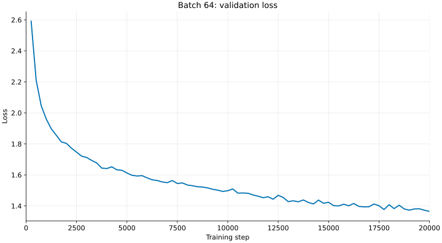
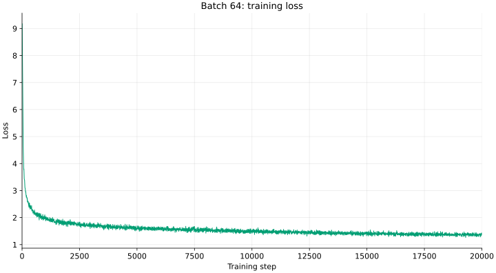

# LLM from Scratch

An end-to-end PyTorch implementation of a Transformer language model and training infrastructure, based on the Stanford CS336 specifications.

## Repository Structure
- `assignment1-basics/` - Custom BPE Tokenizer, Transformer Architecture (RMSNorm, SwiGLU, RoPE, Multi-Head Attention)
- `notes/` - Learning notes across assignments (see below)

## Trained Model

TinyStories language model from `assignment1-basics/`, trained with batch size
64 and peak learning rate `1e-3`. It had the lowest final validation loss
among the completed runs in the batch-size sweep.

| Item | Value |
|---|---|
| Parameters | 22,696,448 (vocab 10,000, context 256, d_model 512, 4 layers, 16 heads, d_ff 1344) |
| Training tokens | 327,680,000 (20,000 steps × batch 64 × context 256) |
| Training hardware | 1× NVIDIA RTX 4090 (24 GB), FP32 |
| Training time | 3,178 s (about 53 min) |
| Final training / validation loss | 1.3844 / 1.3647 |

| Validation loss | Training loss |
| --- | --- |
|  |  |

Both curves show raw logged values without smoothing. Validation was measured
every 250 steps; training loss was logged every 5 steps.

See the [batch-size sweep](notes/a1-batch-size-sweep.md),
[learning-rate sweep](notes/a1-learning-rate-sweep.md), and
[experiment notes](notes/a1-llm-experiments.md) for comparisons and details.

Sample generated from this checkpoint (prompt `<|endoftext|>`, temperature 0.8, top-p 0.9, seed 0; stopped at the model's own `<|endoftext|>`):

```text
<|endoftext|>
Once upon a time, there was a little girl named Lucy. She had a pretty skirt that she loved very much. One day, she wanted to wear her skirt to play outside with her friends.
While playing, Lucy fell down and hurt her knee. She started to cry. Her mom heard her and came to help her. "Don't worry, Lucy," her mom said. "We can fix your knee and make it feel better."
Lucy's mom took out some soft cloth and wrapped it around her knee. She kissed it and said, "There, all better now. Let's go to the doctor."
At the doctor, the doctor looked at Lucy's knee and said, "You need to rest and rest. You will feel better soon." Lucy felt a little better. She went back to her friends and they all played together again.
<|endoftext|>
```

## Learning Notes

Write-ups of what I measured and learned along the way. Naming: `aN-<topic>.md` per assignment.

| Assignment | Note | Key takeaway |
|---|---|---|
| A1 | [BPE: TinyStories vs OpenWebText](notes/a1-bpe-tinystories-vs-owt.md) | Vocab reflects corpus: clean data gives word-like tokens, noisy web data wastes slots on junk runs and mojibake |
| A1 | [LLM implementation](notes/a1-llm-implementation.md) | RMSNorm, linear (no bias), SwiGLU, RoPE, and numerical precision: matmuls can use low precision, but positions, norms, softmax, and optimizer state need float32 |
| A1 | [LLM experiments](notes/a1-llm-experiments.md) | Training experiments. |
| A1 | [Learning-rate sweep](notes/a1-learning-rate-sweep.md) | Compare five learning-rate schedules on TinyStories using full training and validation histories. |
| A1 | [Batch-size sweep](notes/a1-batch-size-sweep.md) | Compare batch sizes by token budget, runtime, utilization, and memory. |
| A1 | [Ablation experiments](notes/a1-ablation-experiments.md) | Compare ablations, starting with no-RMSNorm runs against an existing baseline. |
| General | [Tensor operations](notes/tensor-operations.md) | Track shapes, not values: indexing, broadcasting, einsum, stack/cat, rearrange, and masking |
