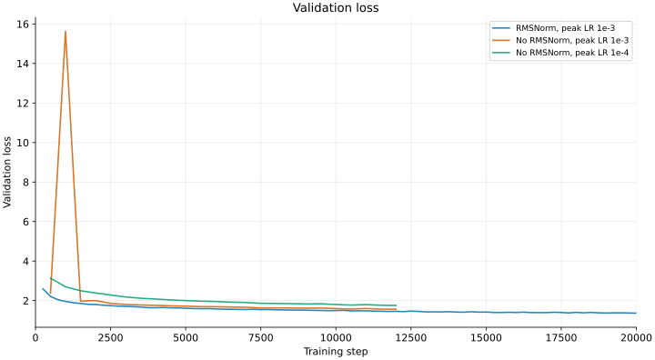
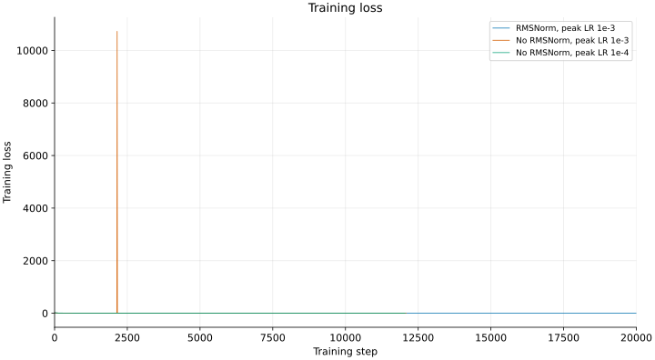
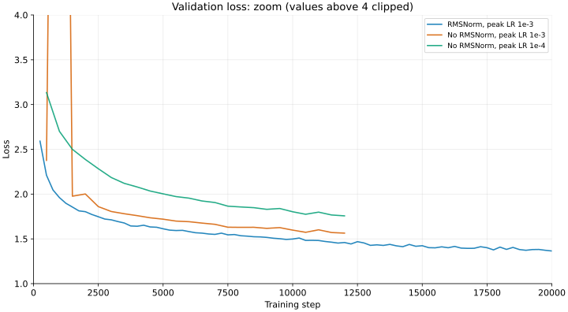
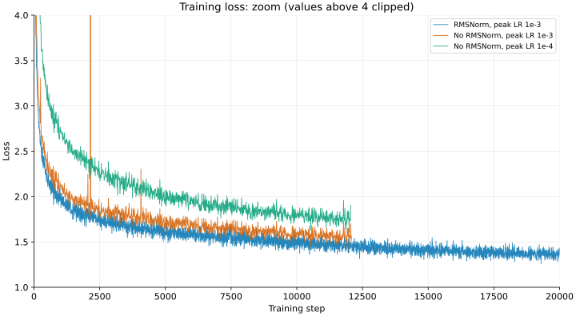
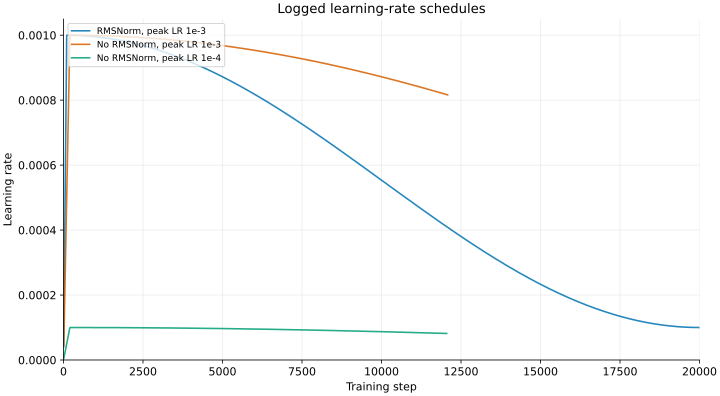
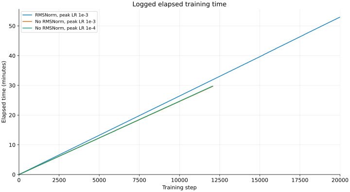
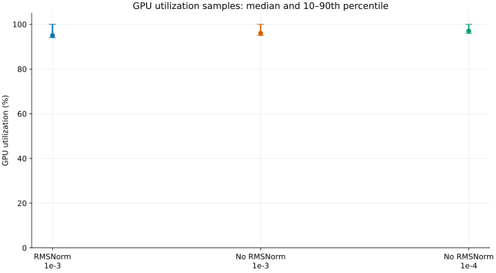
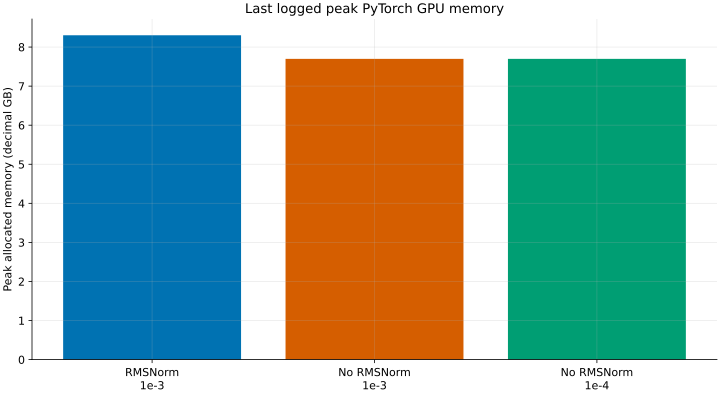

# Ablation experiments: TinyStories

## 1. No-RMSNorm experiments

### Summary

Two batch-64 runs removed RMSNorm and used peak learning rates of `1e-3` and
`1e-4`. At the last common evaluation, **step 12,000**, their validation
losses were **1.5641** and **1.7570**, respectively. The existing
RMSNorm batch-64 run reached **1.4592** at the same step, but used a shorter
learning-rate schedule; this is **not a controlled normalization-only
ablation**.

The main observation is **training stability**: without RMSNorm, the run
using the same peak LR as the reference (`1e-3`) had dramatic transient loss
spikes. Reducing the peak LR to `1e-4` produced no comparable spikes in the
logged data, suggesting more stable training, but its validation loss was
worse than the RMSNorm reference at the matched steps shown. The `1e-3`
run recovered to a validation loss of 1.5641 by step 12,000; all logged
losses were finite, so this is not a permanent numerical divergence.

### Experiment setup

| Item | Setting |
| --- | --- |
| Dataset and model | TinyStories; vocabulary 10,000; context 256; width 512; 4 layers; 16 heads; feed-forward width 1,344 |
| Normalization | No-RMSNorm runs replace the two per-block RMSNorms and the final RMSNorm with identity operations |
| Shared training settings | Batch 64; seed 0; AdamW betas `(0.9, 0.95)`, epsilon `1e-8`, weight decay `0.1`, gradient clipping 1.0; CUDA |
| No-RMSNorm schedules | Peak/min LR `1e-3`/`1e-4` and `1e-4`/`1e-5`; 200-step warmup; 40,000-step decay horizon |
| No-RMSNorm logging | Training loss and LR every 10 steps; validation every 500 steps, averaging 20 validation batches |
| Runtime cap | Script defaults to 30 minutes per run; the limit is configurable |
| Existing reference | Batch-64 RMSNorm run with peak/min LR `1e-3`/`1e-4`, 100-step warmup and 20,000-step decay horizon |

Settings come from the exported run configurations and the
[no-RMSNorm script](../assignment1-basics/scripts/train_no_rmsnorm.sh).
The reference was the completed batch-64 run from the
[batch-size sweep](a1-batch-size-sweep.md). That RMSNorm reference logs
training every 5 steps, validates every 250 steps, and checkpoints every
250 steps; the no-RMSNorm runs validate every 500 steps and checkpoint every
1,000 steps. Differences in schedule, checkpointing,
logging, and model normalization prevent a causal attribution to
normalization alone.

### Run status and matched-step validation

The export is a snapshot from **2026-11-06 09:00:53 UTC**. The `1e-4` run
was still marked `running` by W&B at retrieval; its final state and any
subsequent metrics are not established by this export. The `1e-3` run was
marked `crashed` after approximately 29.7 minutes, consistent with the
script's default timeout but not, by itself, proof of its cause.

| Run | W&B state at export | Last logged step | Last logged training tokens | Last logged elapsed |
| --- | --- | ---: | ---: | ---: |
| RMSNorm, `1e-3` | Finished | 20,000 | 327.680M | 53.0 min |
| No RMSNorm, `1e-3` | Crashed | 12,080 | 197.919M | 29.7 min |
| No RMSNorm, `1e-4` | Running | 12,050 | 197.427M | 29.7 min |

All three use batch 64 and context 256, so a matched step corresponds to the
same nominal training token count. Validation is sampled, not measured on a
fixed full validation set.

| Run | Step 500 | Step 5,000 | Step 10,000 | Step 12,000 |
| --- | ---: | ---: | ---: | ---: |
| RMSNorm, `1e-3` | 2.2105 | 1.6126 | 1.4981 | **1.4592** |
| No RMSNorm, `1e-3` | 2.3765 | 1.7198 | 1.5977 | 1.5641 |
| No RMSNorm, `1e-4` | 3.1336 | 2.0027 | 1.8026 | 1.7570 |

Step 12,000 corresponds to 196.608M training tokens. Neither no-RMSNorm run
reached the reference's 20,000-step endpoint in this snapshot.

### Learning curves and schedule

| Validation loss: full scale | Training loss: full scale |
| --- | --- |
|  |  |

These are raw, unsmoothed logged values, including the earliest available
steps. At peak LR `1e-3`, the no-RMSNorm run logged validation loss **15.6234**
at step 1,000 and training loss **10,723.3506** at step 2,150. The large
training spike makes the rest of the full-scale plot hard to see.

| Validation loss: zoom | Training loss: zoom |
| --- | --- |
|  |  |

The zoomed plots use a loss range of 1–4; values outside that range are
**clipped from view**, not removed from the underlying data. Refer to the
full-scale plots for the spikes.

| Learning-rate schedule | Elapsed time |
| --- | --- |
|  |  |

At step 12,000 the logged LR was approximately `8.19e-4` for no RMSNorm
at peak `1e-3`, but `4.14e-4` for the RMSNorm reference: matching peak LR
does not match the schedule at the comparison point. Logged elapsed times
at that step were approximately 1,770 seconds for no RMSNorm `1e-3` and
1,902 seconds for the reference. These include previous evaluation and
checkpoint overhead and are not a controlled kernel benchmark.

### GPU utilization and memory

| GPU utilization | Peak allocated GPU memory |
| --- | --- |
|  |  |

GPU points are medians, with 10th–90th percentile whiskers from returned
W&B `system.gpu.0.gpu` samples, not confidence intervals. The reference has
211 samples and each no-RMSNorm run has 119; W&B's recorded counts differed
from the returned counts, so completeness is unverified. Their observation
periods differ.

Peak memory is the **last logged process peak of PyTorch-allocated memory**
in decimal GB, not total GPU or reserved memory: 8.303 GB for the reference
versus 7.699 GB for each no-RMSNorm run. The reference covers a longer
training interval; these figures are descriptive, not isolated causal
measurements.

### Observations and next steps

- **High learning rate without RMSNorm was unstable in this run.** With
  the same peak LR `1e-3` as the RMSNorm reference, the no-RMSNorm run
  logged training loss 10,723.3506 at step 2,150 and validation loss
  15.6234 at step 1,000. It subsequently recovered: validation loss was
  1.9765 at step 1,500 and 1.5641 at step 12,000.
- **Reducing the learning rate appeared to improve stability, at a cost in
  loss.** No comparable spikes were logged for no RMSNorm at peak `1e-4`;
  however, its step-12,000 validation loss was 1.7570, versus 1.5641 for
  no RMSNorm at `1e-3` and 1.4592 for the RMSNorm reference.
- **These results suggest a stability tradeoff, not a controlled causal
  result.** The reference and no-RMSNorm schedules differ, the lower-LR
  run changes the full schedule as well as the peak, and each has one seed.
  Neither no-RMSNorm run completed its planned 40,000-step schedule in this
  snapshot; unlogged steps may behave differently.
- For a cleaner ablation, compare RMSNorm on and off with the same model
  dimensions, seed, batch size, warmup, LR schedule, logging and evaluation
  settings, and equal training budgets. Repeat seeds and evaluate on a fixed
  validation set before drawing a general conclusion.

### Sources

The [export guide](../results/wandb-no-rmsnorm/README.md) describes the
snapshot and GPU-sample limitations. W&B configuration and state are in
[runs.json](../results/wandb-no-rmsnorm/runs.json).

| Run | W&B | Training history | GPU samples |
| --- | --- | --- | --- |
| No RMSNorm `1e-3` | [bnsbraf1](https://wandb.ai/yangjuns-cmu-google/cs336-assignment1/runs/bnsbraf1) | [CSV](../results/wandb-no-rmsnorm/no-rmsnorm-lr-1e-3--bnsbraf1.csv) | [CSV](../results/wandb-no-rmsnorm/no-rmsnorm-lr-1e-3--bnsbraf1--gpu-utilization.csv) |
| No RMSNorm `1e-4` | [88ru5c6v](https://wandb.ai/yangjuns-cmu-google/cs336-assignment1/runs/88ru5c6v) | [CSV](../results/wandb-no-rmsnorm/no-rmsnorm-lr-1e-4--88ru5c6v.csv) | [CSV](../results/wandb-no-rmsnorm/no-rmsnorm-lr-1e-4--88ru5c6v--gpu-utilization.csv) |
| RMSNorm reference | [sya3qpqg](https://wandb.ai/yangjuns-cmu-google/cs336-assignment1/runs/sya3qpqg) | [CSV](../results/wandb-sweeps/batch-64-lr-1e-3--sya3qpqg.csv) | [CSV](../results/wandb-sweeps/batch-64-lr-1e-3--sya3qpqg--gpu-utilization.csv) |
