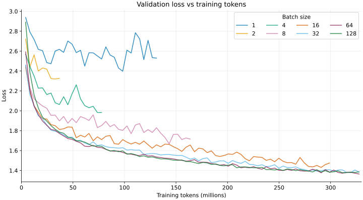
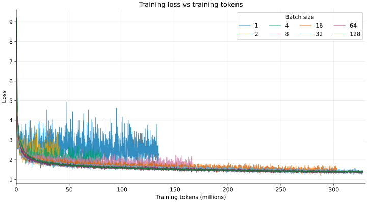
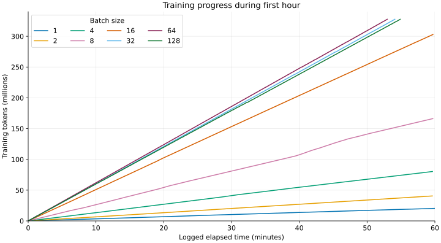
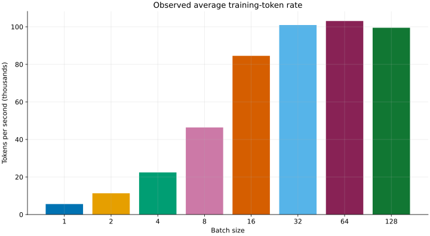
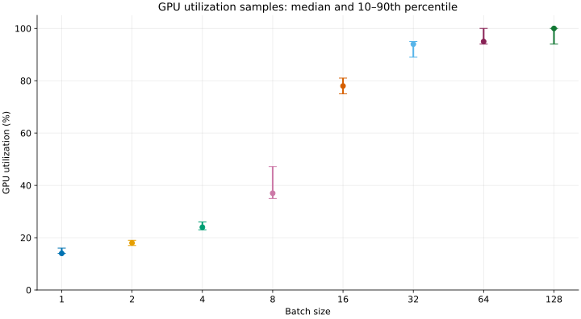
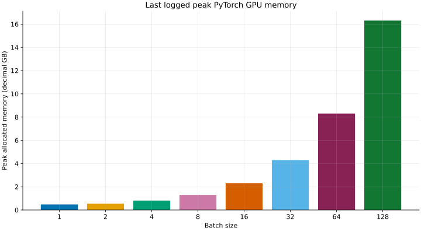

# Batch-size sweep: TinyStories

## Summary

The goal was to compare batch sizes at a fixed training budget of
**327.68 million tokens**. Batch sizes **32, 64, and 128** completed that
budget in under an hour. Batch sizes 2–16 were stopped at the one-hour cap
before reaching it. The batch-1 run was a separate, longer attempt and was
manually killed; batch 256 ran out of GPU memory before logging metrics.
There is no batch-512 run in the export.

Of the completed runs, **batch 64** had the lowest final validation loss
(1.3647) and the highest observed average token rate (approximately
103,100 tokens/s). This is one seed and one run per batch size, not evidence
that 64 is universally optimal. Losses at the ends of stopped runs are **not**
directly comparable to the completed runs: they saw different token counts.

## Experiment setup

| Item | Setting |
| --- | --- |
| Dataset and model | TinyStories; 22,696,448 parameters; context length 256; width 512; 4 layers; 16 heads; feed-forward width 1,344 |
| Hardware and precision | One RTX 4090, 24 GB, FP32 |
| Batch sizes | 1, 2, 4, 8, 16, 32, 64, 128, 256; 512 was planned but has no exported run |
| Optimizer | AdamW; betas `(0.9, 0.95)`; epsilon `1e-8`; weight decay `0.1`; gradient clipping at 1.0 |
| LR schedule | Peak `1e-3`, minimum `1e-4`; warmup and schedule horizon scaled by batch size to align with token count |
| Target | 40,000 steps × batch 32 × context 256 = **327,680,000 training tokens** |
| Evaluation | 20 validation batches every approximately 4.096 million training tokens |
| Seed | 0 for each run |

The [batch sweep script](../assignment1-basics/scripts/sweep_batch_size.sh)
uses a one-hour timeout and scales the training horizon, warmup, and logging
intervals with batch size. The user reports that batch 1 was first attempted
without that one-hour cap and manually stopped; the sweep was then rerun
starting at batch 2 with a one-hour cap per run. W&B labels batch 1 `killed`
and batches 2–16 `crashed`; the latter stopped near an hour, consistent with
that timeout context. Their W&B states should not be read as proof of
numerical failure. The original batch-1 configuration also recorded a
checkpoint interval of 160,000 steps rather than the later script's 16,000.

## Outcomes

Training tokens and elapsed time are from the **last logged** step; they can
understate the actual stopping point. The last validation loss may be from
an earlier step. The small-run validation losses below therefore describe
different token budgets and should not be ranked against completed runs.

| Batch | W&B state / context | Last logged step | Training tokens (M) | Target | Last logged elapsed (min) | Last validation loss (M tokens) |
| ---: | --- | ---: | ---: | ---: | ---: | ---: |
| 1 | Killed; separate long run | 524,480 | 134.267 | 41.0% | 400.6 | 2.5296 (131.072) |
| 2 | Crashed; one-hour cap | 79,200 | 40.550 | 12.4% | 59.6 | 2.3257 (36.864) |
| 4 | Crashed; one-hour cap | 78,400 | 80.282 | 24.5% | 59.6 | 1.9830 (77.824) |
| 8 | Crashed; one-hour cap | 81,160 | 166.216 | 50.7% | 59.7 | 1.7157 (163.840) |
| 16 | Crashed; one-hour cap | 73,960 | 302.940 | 92.5% | 59.7 | 1.4747 (299.008) |
| 32 | Finished | 40,000 | 327.680 | 100% | 54.1 | 1.3838 (327.680) |
| 64 | Finished | 20,000 | 327.680 | 100% | 53.0 | 1.3647 (327.680) |
| 128 | Finished | 10,000 | 327.680 | 100% | 54.9 | 1.3859 (327.680) |
| 256 | Failed; CUDA OOM | — | — | — | — | — |

Batch 128's final history row is validation-only at step 10,000. Its last
`elapsed_s` and training-loss record are at step 9,999, so its reported
elapsed time and throughput exclude the last step and final evaluation.
Likewise, `elapsed_s` is logged before any evaluation or checkpoint at that
step; it is not necessarily the complete wall-clock runtime.

## Loss at matched token counts

| Validation loss | Training loss |
| --- | --- |
|  |  |

Both graphs show the raw logged values without smoothing and include the
earliest available points. Curves stop at the last available measurement;
no stopped run is extrapolated. Validation occurs at different step counts
but at matching token intervals for these runs.

| Batch | Validation at 36.864M tokens | Validation at 131.072M tokens | Validation at 327.680M tokens |
| ---: | ---: | ---: | ---: |
| 1 | 2.6180 | 2.5296 | — |
| 2 | 2.3257 | — | — |
| 4 | 2.0629 | — | — |
| 8 | 1.8980 | 1.8295 | — |
| 16 | 1.8120 | 1.6579 | — |
| 32 | 1.7813 | 1.5674 | 1.3838 |
| 64 | 1.7722 | 1.5349 | **1.3647** |
| 128 | 1.7858 | **1.5251** | 1.3859 |

Although validation uses 20 batches for every run, each batch contains
`batch size × 256` tokens: batch 1 evaluates 5,120 tokens per measurement,
while batch 128 evaluates 655,360. Smaller-batch validation estimates can
therefore be noisier. Batch size also changes the number of optimizer updates
at a given token count; this experiment does not isolate a single effect.

## Time, utilization, and memory

| Progress during the first hour | Observed average token rate |
| --- | --- |
|  |  |

The progress plot uses logged `elapsed_s` and shows only the **first hour**,
including the first hour of the longer batch-1 run. Throughput is last timed
step × batch size × context length divided by the corresponding `elapsed_s`.
It is a run-average training-token rate, including prior evaluation and
checkpoint overhead, not a pure GPU-kernel benchmark. The batch-1 bar uses
its full roughly 6.7-hour recorded run; others use their last timed records.

| GPU utilization | Peak allocated GPU memory |
| --- | --- |
|  |  |

GPU utilization is W&B's `system.gpu.0.gpu` percentage. Points show the
median of returned samples and whiskers the 10th–90th percentiles, not
confidence intervals. Samples were requested with a 10,000-event limit;
W&B's recorded counts differ from the returned counts, so completeness
is unverified. Batch 1 includes samples from its entire longer run. The GPU
was generally more utilized at larger batches: observed medians rise from
14% at batch 1 to 95% at batch 64 and 100% at batch 128.

Memory is the last logged `torch.cuda.max_memory_allocated` in decimal GB,
the process's running peak of **PyTorch-allocated** memory—not total device
or reserved memory. Batch 64 logged 8.303 GB and batch 128 16.307 GB.
Batch 256 has no logged peak: its CUDA OOM is documented in the
[existing experiment notes](a1-llm-experiments.md). The failed allocation
is not a measured peak; batch 512 was not tested in the exported sweep.

## Observations and next steps

- **A matched-token comparison is only complete for 32, 64 and 128.**
  They reach 327.68M tokens and end at validation losses 1.3838, 1.3647
  and 1.3859. Batch 64's advantage is modest and needs repeat seeds.
- **The one-hour cap strongly favors larger batches in tokens processed.**
  Batch 2 logged 40.55M tokens, batch 8 166.22M, and batch 16 302.94M.
  At the common 36.864M-token evaluation, batch 64's validation loss was
  1.7722 versus 2.3257 for batch 2; validation sample sizes differ.
- **Throughput saturates while memory rises.** Measured run-average rates
  are about 101k, 103k, and 99.5k tokens/s at batches 32, 64, and 128,
  respectively, while peak allocated memory rises from 4.297 to 16.307 GB.
  The timings include logging, evaluation, and checkpoint overhead.
- **For a stronger comparison**, rerun 32, 64 and 128 with multiple seeds
  and a fixed validation token count or fixed evaluation dataset. To compare
  small batches at the full budget, extend the time limit; gradient
  accumulation can test a larger effective batch with smaller microbatches,
  but is a different experiment from these direct batch-size runs.

## Sources

The [export guide](../results/wandb-sweeps/README.md) describes the history
and GPU telemetry exports. Configurations, W&B state and run links are in
[runs.json](../results/wandb-sweeps/runs.json).

| Batch | W&B run | Training history | GPU samples |
| ---: | --- | --- | --- |
| 1 | [j2hgt3wi](https://wandb.ai/yangjuns-cmu-google/cs336-assignment1/runs/j2hgt3wi) | [CSV](../results/wandb-sweeps/batch-1-lr-1e-3--j2hgt3wi.csv) | [CSV](../results/wandb-sweeps/batch-1-lr-1e-3--j2hgt3wi--gpu-utilization.csv) |
| 2 | [3jil4aap](https://wandb.ai/yangjuns-cmu-google/cs336-assignment1/runs/3jil4aap) | [CSV](../results/wandb-sweeps/batch-2-lr-1e-3--3jil4aap.csv) | [CSV](../results/wandb-sweeps/batch-2-lr-1e-3--3jil4aap--gpu-utilization.csv) |
| 4 | [i3tgnaho](https://wandb.ai/yangjuns-cmu-google/cs336-assignment1/runs/i3tgnaho) | [CSV](../results/wandb-sweeps/batch-4-lr-1e-3--i3tgnaho.csv) | [CSV](../results/wandb-sweeps/batch-4-lr-1e-3--i3tgnaho--gpu-utilization.csv) |
| 8 | [6kfmz2xz](https://wandb.ai/yangjuns-cmu-google/cs336-assignment1/runs/6kfmz2xz) | [CSV](../results/wandb-sweeps/batch-8-lr-1e-3--6kfmz2xz.csv) | [CSV](../results/wandb-sweeps/batch-8-lr-1e-3--6kfmz2xz--gpu-utilization.csv) |
| 16 | [pp8w8c5z](https://wandb.ai/yangjuns-cmu-google/cs336-assignment1/runs/pp8w8c5z) | [CSV](../results/wandb-sweeps/batch-16-lr-1e-3--pp8w8c5z.csv) | [CSV](../results/wandb-sweeps/batch-16-lr-1e-3--pp8w8c5z--gpu-utilization.csv) |
| 32 | [z6ch2xht](https://wandb.ai/yangjuns-cmu-google/cs336-assignment1/runs/z6ch2xht) | [CSV](../results/wandb-sweeps/batch-32-lr-1e-3--z6ch2xht.csv) | [CSV](../results/wandb-sweeps/batch-32-lr-1e-3--z6ch2xht--gpu-utilization.csv) |
| 64 | [sya3qpqg](https://wandb.ai/yangjuns-cmu-google/cs336-assignment1/runs/sya3qpqg) | [CSV](../results/wandb-sweeps/batch-64-lr-1e-3--sya3qpqg.csv) | [CSV](../results/wandb-sweeps/batch-64-lr-1e-3--sya3qpqg--gpu-utilization.csv) |
| 128 | [ogtn0l5c](https://wandb.ai/yangjuns-cmu-google/cs336-assignment1/runs/ogtn0l5c) | [CSV](../results/wandb-sweeps/batch-128-lr-1e-3--ogtn0l5c.csv) | [CSV](../results/wandb-sweeps/batch-128-lr-1e-3--ogtn0l5c--gpu-utilization.csv) |
| 256 | [rot2j85j](https://wandb.ai/yangjuns-cmu-google/cs336-assignment1/runs/rot2j85j) | [Header-only CSV](../results/wandb-sweeps/batch-256-lr-1e-3--rot2j85j.csv) | None returned |
