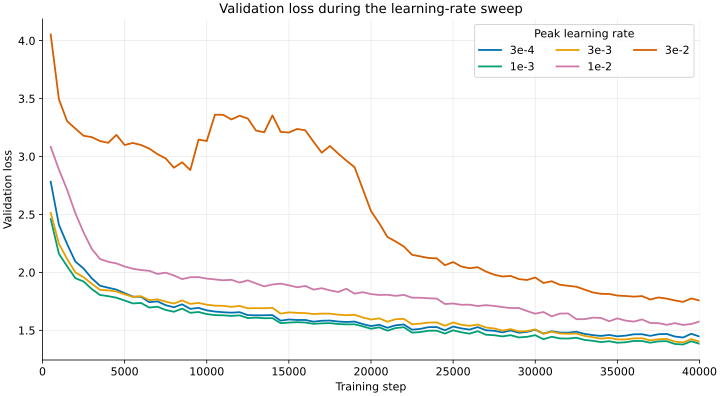
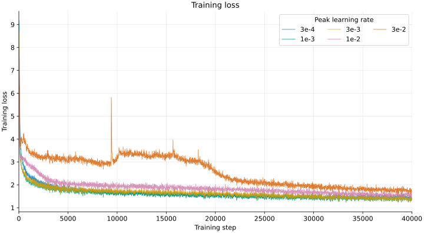
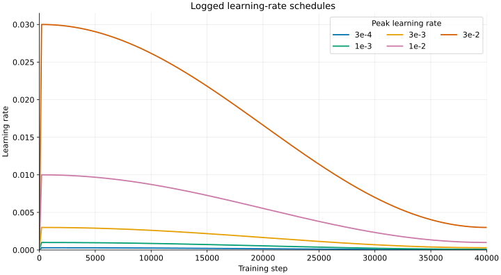
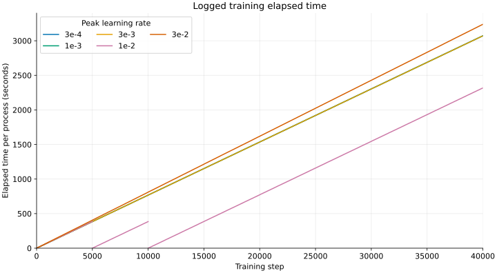
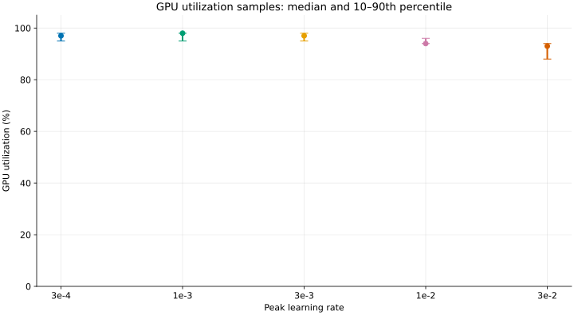
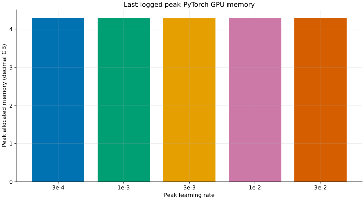

# Learning-rate sweep: TinyStories

## Summary

Among the five schedules tested, a **peak learning rate of `1e-3`** had the
lowest validation loss at the shared 40,000-step endpoint: **1.3838**.
The `3e-3` run was close at 1.4025; `3e-4` was slower to improve and ended
at 1.4461. The higher rates, `1e-2` and `3e-2`, ended substantially worse
at 1.5759 and 1.7570, respectively. All five runs completed with finite
logged losses; the highest rate did not diverge to a non-finite value, but
its validation curve was much worse and temporarily rose during training.

This is a comparison of **one seed per schedule**, not a statistical
estimate of the best learning rate in general.

## Experiment setup

| Item | Setting |
| --- | --- |
| Dataset | Tokenized TinyStories training and validation splits |
| Model | 22,696,448 parameters; vocabulary 10,000; context 256; width 512; 4 layers; 16 heads; feed-forward width 1,344 |
| Optimizer | AdamW; betas `(0.9, 0.95)`; epsilon `1e-8`; weight decay `0.1`; gradient clipping at 1.0 |
| Sweep | Peak LR: `3e-4`, `1e-3`, `3e-3`, `1e-2`, `3e-2`; minimum LR is one tenth of the peak |
| Schedule | 200-step warmup, followed by decay over the 40,000-step training horizon; logged schedules are shown below |
| Training | Batch size 32; 40,000 steps; seed 0; CUDA, FP32 |
| Token budget | 8,192 training tokens per step; **327,680,000 tokens** per run, excluding validation |
| Logging | Training loss and LR every 10 steps; validation every 500 steps, averaging 20 validation batches |

Settings are from the exported W&B configurations; the model parameter count
and FP32 hardware context are recorded in the existing
[experiment notes](a1-llm-experiments.md). The
[higher-rate sweep script](../assignment1-basics/scripts/sweep_learning_rate_higher.sh)
specifies the `1e-2` and `3e-2` runs. The lower-rate runs' recorded
configurations are in [runs.json](../results/wandb-sweeps/runs.json).

## Validation results

The table compares validation losses at the same steps. Best observed loss is
the minimum among the 80 logged evaluations, not a continuous measurement.

| Peak LR | Step 500 | Step 5,000 | Step 20,000 | Step 40,000 | Best logged loss (step) |
| ---: | ---: | ---: | ---: | ---: | ---: |
| `3e-4` | 2.7821 | 1.8207 | 1.5366 | 1.4461 | 1.4379 (39,000) |
| `1e-3` | 2.4606 | 1.7571 | 1.5135 | **1.3838** | **1.3775** (39,000) |
| `3e-3` | 2.5137 | 1.8110 | 1.5931 | 1.4025 | 1.3954 (39,000) |
| `1e-2` | 3.0827 | 2.0511 | 1.8128 | 1.5759 | 1.5461 (39,000) |
| `3e-2` | 4.0527 | 3.0993 | 2.5288 | 1.7570 | 1.7453 (39,000) |

## Learning curves and schedule

| Validation loss | Training loss |
| --- | --- |
|  |  |

The curves show the raw logged validation values, without smoothing. Each
evaluation uses sampled validation batches, so small point-to-point changes
can include evaluation noise.

The training plot shows all raw training-loss values, logged every 10 steps,
without smoothing; the first logged point is at step 10.

| Learning-rate schedule | Elapsed time |
| --- | --- |
|  |  |

The schedule uses a linear vertical axis. Each run changes both peak and
minimum LR together, so the results compare entire schedules rather than
isolating peak LR while holding the final LR fixed.

`elapsed_s` is the elapsed time reported by each training process, including
evaluation and checkpoint work. The `1e-2` run was resumed twice; the line
breaks and resets near steps 5,000 and 10,000 are intentional. Its final
2,318 seconds are **not** the total time for the complete run.

## GPU utilization and memory

| GPU utilization | Peak allocated GPU memory |
| --- | --- |
|  |  |

GPU utilization is W&B's `system.gpu.0.gpu` percentage, sampled approximately
every 15 seconds. Points show the median of returned samples and whiskers the
10th–90th percentiles, not confidence intervals. These are not time-weighted
statistics or a direct measure of training throughput. A request for up to
10,000 W&B system events returned 204 GPU samples per run, except 215 for
`3e-2`; W&B's metric counts differed from the returned counts, so completeness
could not be confirmed. The resumed `1e-2` run has gaps in its telemetry.

The memory plot shows the last logged `torch.cuda.max_memory_allocated` in
decimal GB: the running peak **PyTorch-allocated** GPU memory for each
process, not total device memory or reserved allocator memory. All are about
4.30 GB. A restart resets the process's peak counter, so the `1e-2` bar
reflects its final process, not necessarily the peak across all segments.

## Observations and conclusions

- **`1e-3` is the strongest candidate in this sweep.** It has the lowest
  measured validation loss at steps 500, 5,000, 20,000 and 40,000. It first
  logs validation loss below 1.5 at step 21,000, compared with 24,500 for
  `3e-4` and 28,000 for `3e-3`; the two larger rates never log a value below
  1.5. These crossings are limited to the 500-step evaluation cadence.
- **The gap between `1e-3` and `3e-3` narrows late in training.** At
  step 20,000 the gap is 0.0796 loss; by step 40,000 it is 0.0187. This
  suggests that assessing only early training would overstate their endpoint
  difference for this schedule.
- **The largest schedule is unstable-looking but not a numerical failure.**
  Its validation loss rises from about 2.88 at step 9,000 to about 3.36 at
  step 10,500, before improving later. The recorded values are finite and
  the run finishes; the curve alone does not establish the underlying cause.
- **Memory and utilization:** all five final logged PyTorch peaks are about
  4.30 GB, consistent with the shared model and batch size. GPU samples are
  generally high, but occasional dips and the incomplete-sampling caveat
  make them insufficient to attribute timing differences to learning rate.
- **Use the final comparison carefully.** All runs use the same nominal
  token budget and seed, but have only one trial each. Validation batches
  are sampled, and `1e-2` was resumed: `elapsed_s` resets just after steps
  5,000 and 10,000. The final W&B configuration records a resume checkpoint,
  so timing and exact random-sample continuity should not be assumed
  comparable. Checkpoint intervals also differ: 1,000 steps for the three
  lower-rate runs and 5,000 for the two higher-rate runs.

For a stronger conclusion, repeat the promising `1e-3` and `3e-3` schedules
with multiple seeds and compare validation at the same token budget. A
follow-up that varies the minimum LR separately would distinguish its effect
from the peak.

## Sources

The [export guide](../results/wandb-sweeps/README.md) describes the
unsampled history export and columns. The comparisons use `val_loss`, not
`valid_loss`; no W&B chart downsampling was used.

| Peak LR | W&B run | Exported history | GPU samples |
| --- | --- | --- | --- |
| `3e-4` | [09kcs5gv](https://wandb.ai/yangjuns-cmu-google/cs336-assignment1/runs/09kcs5gv) | [CSV](../results/wandb-sweeps/lr-3e-4--09kcs5gv.csv) | [CSV](../results/wandb-sweeps/lr-3e-4--09kcs5gv--gpu-utilization.csv) |
| `1e-3` | [18z6f6q3](https://wandb.ai/yangjuns-cmu-google/cs336-assignment1/runs/18z6f6q3) | [CSV](../results/wandb-sweeps/lr-1e-3--18z6f6q3.csv) | [CSV](../results/wandb-sweeps/lr-1e-3--18z6f6q3--gpu-utilization.csv) |
| `3e-3` | [3ges9qr4](https://wandb.ai/yangjuns-cmu-google/cs336-assignment1/runs/3ges9qr4) | [CSV](../results/wandb-sweeps/lr-3e-3--3ges9qr4.csv) | [CSV](../results/wandb-sweeps/lr-3e-3--3ges9qr4--gpu-utilization.csv) |
| `1e-2` | [jok4zzpi](https://wandb.ai/yangjuns-cmu-google/cs336-assignment1/runs/jok4zzpi) | [CSV](../results/wandb-sweeps/lr-1e-2--jok4zzpi.csv) | [CSV](../results/wandb-sweeps/lr-1e-2--jok4zzpi--gpu-utilization.csv) |
| `3e-2` | [dymf17zq](https://wandb.ai/yangjuns-cmu-google/cs336-assignment1/runs/dymf17zq) | [CSV](../results/wandb-sweeps/lr-3e-2--dymf17zq.csv) | [CSV](../results/wandb-sweeps/lr-3e-2--dymf17zq--gpu-utilization.csv) |
