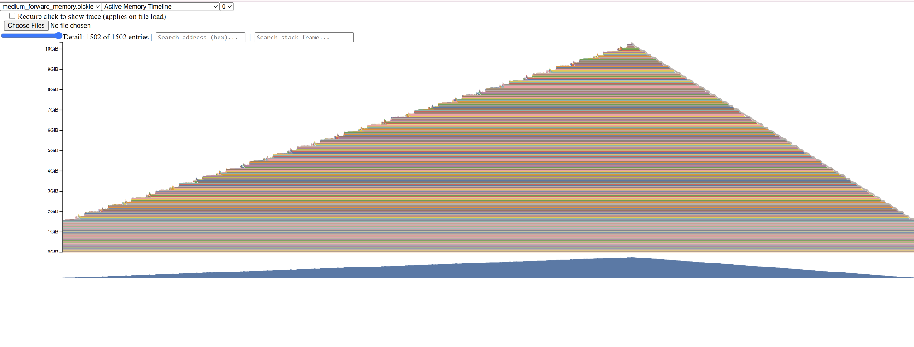
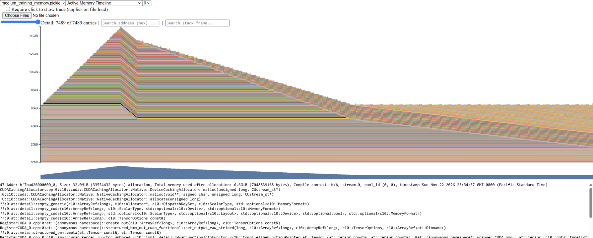
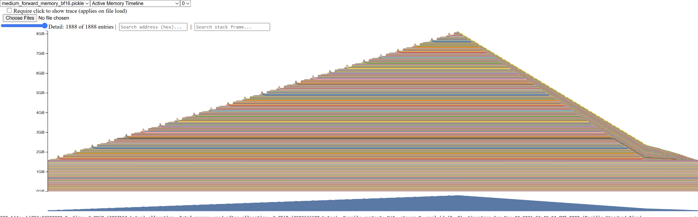
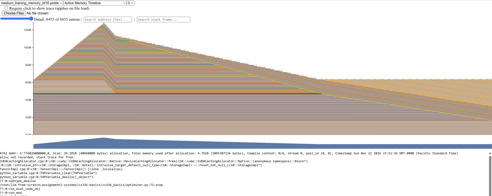

# Assignment 2: Model-size benchmarking

## Experiment setup

The baseline results below are from the supplied remote GPU run with
5 warmup steps. A second run without warmup is compared later in this note.

| Setting | Value |
| --- | --- |
| GPU | NVIDIA GeForce RTX 4090; 23.52 GiB reported capacity |
| Model | Staff `BasicsTransformerLM`, random weights and inputs |
| Precision | Default FP32; no mixed precision enabled |
| Vocabulary size | 10,000 |
| Batch size | 4 |
| Context length | 512 |
| Warmup | 5 steps per configuration and mode |
| Measurements | 10 individually timed steps after warmup |
| Timing | `timeit.repeat`, with CUDA synchronization after each step |
| Statistics | Mean and population standard deviation across the 10 steps |

The [benchmark](../assignment2-systems/cs336_systems/benchmark.py) measures
forward-only, forward plus backward, and forward plus backward plus AdamW.
The [sweep script](../assignment2-systems/scripts/benchmark_model_sizes.sh)
runs each model size in each mode and overwrites
`assignment2-systems/results/benchmark_model_sizes.log` on each invocation.

## Measured timings

All timings are in **milliseconds per step**. Forward-plus-backward and
full-step timings are combined measurements, not isolated component timings.

| Model | Parameters | Mode | Mean (ms) | Population std (ms) |
| --- | ---: | --- | ---: | ---: |
| Small | 128,625,408 | Forward | 24.593 | 0.035 |
| Small | 128,625,408 | Forward + backward | 79.608 | 1.121 |
| Small | 128,625,408 | Forward + backward + optimizer | 88.705 | 0.913 |
| Medium | 423,183,360 | Forward | 76.457 | 2.061 |
| Medium | 423,183,360 | Forward + backward | 233.716 | 2.849 |
| Medium | 423,183,360 | Forward + backward + optimizer | 263.039 | 1.964 |
| Large | 969,411,840 | Forward | 187.170 | 4.644 |
| Large | 969,411,840 | Forward + backward | OOM during warmup | Not measured |
| Large | 969,411,840 | Forward + backward + optimizer | Not run | Not measured |
| XL | Not measured | All modes | Not run | Not measured |
| 10B | Not measured | All modes | Not run | Not measured |

## Observations

- Forward time increased from **24.59 ms** for small to **76.46 ms** for
  medium and **187.17 ms** for large. These are approximately 3.11x and
  7.61x the small-model forward time.
- For small and medium, forward plus backward took approximately **3.24x**
  and **3.06x** the forward-only time. Full steps including AdamW took
  **88.71 ms** and **263.04 ms**, respectively.
- Subtracting the separately measured mode means gives approximate
  incremental backward costs of **55.01 ms** (small) and **157.26 ms**
  (medium), and optimizer-mode increments of **9.10 ms** and **29.32 ms**.
  These are estimates, not directly timed backward or optimizer operations:
  each mode starts a fresh model, and the optimizer mode also clears
  gradients while the backward-only mode accumulates them.
- Variability was modest in this run: standard deviations were about
  **0.14% to 2.70%** of the corresponding means. Ten post-warmup samples
  characterize this run but do not establish variability across repeated
  experiments.

## GPU memory limit and incomplete sweep

The large model completed forward-only timing but failed during the
forward-plus-backward warmup. The failed allocation was **80 MiB**; the
error reported only **53.75 MiB free**, with **21.88 GiB allocated by
PyTorch** and **1.12 GiB reserved but unallocated**. There is no valid
large-model backward timing in this log.

The sweep uses `set -euo pipefail`, so this failure stopped the script.
Large full-step, XL, and 10B configurations were **not attempted**; they
should not be labeled as measured OOM results.

Memory pressure needs to be interpreted in the context of the current
benchmark. Forward-only still builds an autograd graph, and backward-only
does not clear gradients.
The log establishes that this configuration exceeded available memory with
this implementation, not a universal RTX 4090 limit for the model size.

## Warmup comparison

The sweep was repeated with **0 and 1 warmup steps**, each with
**10 individually timed steps**, using the same RTX 4090 and model settings.
All times below are
milliseconds per step; standard deviations are population standard
deviations.

| Model | Mode | 5 warmups mean | 5 warmups std | 0 warmups mean | 0 warmups std | 1 warmup mean | 1 warmup std |
| --- | --- | ---: | ---: | ---: | ---: | ---: | ---: |
| Small | Forward | 24.593 | 0.035 | 38.259 | 41.858 | 24.543 | 0.148 |
| Small | Forward + backward | 79.608 | 1.121 | 99.067 | 60.485 | 78.636 | 0.376 |
| Small | Forward + backward + optimizer | 88.705 | 0.913 | 107.963 | 59.758 | 88.088 | 0.297 |
| Medium | Forward | 76.457 | 2.061 | 88.517 | 41.415 | 74.917 | 0.321 |
| Medium | Forward + backward | 233.716 | 2.849 | 251.392 | 58.058 | 232.054 | 3.322 |
| Medium | Forward + backward + optimizer | 263.039 | 1.964 | 281.569 | 57.386 | 262.697 | 2.545 |
| Large | Forward | 187.170 | 4.644 | 194.108 | 39.144 | 182.118 | 6.669 |

### Observations

- Without warmup, every completed configuration had a higher mean.
  Small-model means increased by approximately **22% to 56%**, medium-model
  means by **7% to 16%**, and large forward time by **3.7%**.
- Variability increased substantially: standard deviations were
  **39 to 60 ms**, compared with approximately **0.035 to 4.644 ms** in
  the warmed-up run. Small forward's standard deviation exceeded its
  mean, showing that the ten timings were far less uniform without warmup.
- These results are consistent with first-use overhead entering the
  measured steps: CUDA library/kernel initialization, allocation of
  gradients, and lazy AdamW state initialization can occur on early
  executions. Model construction and input creation still happen before
  timing, so these are not measurements of the entire program's startup.
  Individual step times were not logged, so the summaries cannot establish
  which step was slow or isolate the source of the overhead.
- The relative mean increase was largest for the fastest configuration,
  consistent with startup costs having a greater proportional effect on
  short steps. This is a comparison of two runs, not a controlled estimate
  of a fixed startup cost.
- Large forward-plus-backward again ran out of memory, this time inside
  the measurement loop rather than warmup. It reported the same **80 MiB**
  failed allocation and **53.75 MiB** free memory. No mean or standard
  deviation was reported for that configuration; large full-step, XL,
  and 10B were again not attempted after the sweep stopped.

The warmed-up run better represents repeated steady-state execution.
The no-warmup run includes first-use effects and therefore reports higher
means and much greater variability. With 1 warmup step, all completed
means were within **3%**
of the five-warmup means, and variability was much smaller than without
warmup. This suggests one step absorbed most first-use overhead in these
runs, not that one warmup is always sufficient. Large forward-plus-backward
still failed in the measurement loop, leaving the remaining configurations
unattempted. Results with 2 warmup steps have not yet been supplied.

## Nsight Systems profiling

The medium model's forward-only run under Nsight Systems took approximately
**88 ms per step**, compared with **76.457 ms** in the earlier unprofiled
five-warmup run. This is about **11.54 ms (15.1%) slower**.

Profiling overhead is a plausible explanation: tracing CUDA operations and
collecting profiling data can perturb execution. However, this comparison
alone does not isolate profiling overhead from run-to-run variation.
Use the unprofiled timings as the performance baseline and the profile to
investigate where execution time is spent.

### Medium model: one profiled full step

The reported components of one profiled medium-model step were:

| Component | Time (ms) |
| --- | ---: |
| Forward | 88.6 |
| Backward | 130.0 |
| AdamW | 68.0 |
| **Sum** | **286.6** |

The component sum is **23.56 ms (9.0%) higher** than the earlier unprofiled
full-step mean of **263.039 ms** with 5 warmup steps. It is also about
**9.1% higher** than the 1-warmup mean of **262.697 ms**, and **1.8% higher**
than the no-warmup mean of **281.569 ms**.

Forward plus backward sums to **218.6 ms**, below the separately measured
unprofiled forward-plus-backward mean of **233.716 ms**. This shows why the
component observations should not be treated as directly interchangeable
with the earlier mode timings: this is one profiled step rather than a
10-step unprofiled average, and the exact timing boundaries may differ.
The **286.6 ms** sum represents total step time only if the component
intervals are non-overlapping and account for the relevant work; gaps or
overlap would require measuring the full step interval separately.

### Dominant forward GPU kernel

For the selected single medium-model forward pass, the CUDA GPU Kernel
Summary reported `ampere_sgemm_128x64_tn` as the largest contributor to
cumulative GPU kernel time:

| Kernel | Share of summed kernel time | Total time | Instances | Mean per invocation |
| --- | ---: | ---: | ---: | ---: |
| `ampere_sgemm_128x64_tn` | 57.0% | 41.460 ms | 167 | 248.263 us |

This matrix-multiplication kernel was invoked **167 times** within the
selected forward interval. The percentage describes summed GPU kernel
durations, not the percentage of end-to-end wall-clock time.

### Forward plus backward: kernel comparison

For the reported single medium-model forward-plus-backward step, the top
three kernels by cumulative GPU time were:

| Kernel | Share of summed kernel time | Total time | Instances | Mean per invocation |
| --- | ---: | ---: | ---: | ---: |
| `ampere_sgemm_128x64_tn` | 18.6% | 41.398 ms | 168 | 246.414 us |
| Vectorized elementwise multiplication (`MulFunctor<float>`) | 11.6% | 25.792 ms | 388 | 66.475 us |
| `cutlass_80_simt_sgemm_256x128_8x4_nn_align1` | 10.7% | 23.703 ms | 73 | 324.695 us |

The same `ampere_sgemm_128x64_tn` kernel remained the largest contributor,
but its share fell from **57.0% to 18.6%** when backward was included.
Its cumulative duration stayed almost unchanged (**41.460 versus
41.398 ms**), while the combined interval included additional work:
other matrix-multiplication kernels and elementwise operations contribute
to the larger denominator. The lower percentage therefore does not mean
this kernel became substantially faster.

The reports show **167 invocations** in the selected forward interval and
**168** in the combined interval. Because these are separate selections or
captures, this difference alone does not identify an additional invocation
as belonging to backward; per-range attribution is needed to establish
that.

### Non-matmul forward kernels (part c)

Besides matrix multiplication, the selected forward pass spent non-trivial
GPU time on the following kernels:

| Operation | Identifier in kernel name | Share of summed kernel time | Total time | Instances |
| --- | --- | ---: | ---: | ---: |
| Binary elementwise multiplication | `BinaryFunctor` with `MulFunctor<float>` | 5.3% | 3.870 ms | 48 |
| Unary/scalar multiplication | `BUnaryFunctor` with `MulFunctor<float>` | 4.8% | 3.459 ms | 24 |
| Exponentiation (`exp`) | `exp_kernel_cuda` | 4.7% | 3.442 ms | 24 |
| Division | `DivFunctor<float>` | 3.8% | 2.773 ms | 24 |
| Addition | `CUDAFunctor_add<float>` | 3.7% | 2.672 ms | 24 |
| Conditional selection (`where`) | `where_kernel_impl` | 3.7% | 2.656 ms | 24 |

The listed non-matmul kernels account for approximately **26.0%** of
summed forward GPU kernel time. Elementwise multiplication alone accounts
for **10.1%**; exponentiation, division, addition, and conditional selection
also contribute appreciably despite performing far fewer FLOPs than
matrix multiplication.

### Complete training step: kernel comparison (part d)

For one measured medium-model forward-plus-backward-plus-AdamW step,
excluding warmup, the reported top five GPU kernels were:

| Kernel | Share of summed kernel time | Total time | Instances | Mean per invocation |
| --- | ---: | ---: | ---: | ---: |
| `ampere_sgemm_128x64_tn` | 16.2% | 40.732 ms | 168 | 242.453 us |
| Binary elementwise multiplication (`MulFunctor<float>`) | 10.2% | 25.753 ms | 388 | 66.374 us |
| `cutlass_80_simt_sgemm_256x128_8x4_nn_align1` | 9.3% | 23.509 ms | 73 | 322.037 us |
| `cutlass_80_simt_sgemm_256x128_8x4_nt_align1` | 8.0% | 20.181 ms | 72 | 280.292 us |
| Vectorized elementwise addition (`CUDAFunctor_add<float>`) | 6.8% | 17.105 ms | 1,333 | 12.831 us |

The leading `ampere_sgemm_128x64_tn` kernel's share decreased from
**57.0%** for forward-only to **18.6%** for forward plus backward and
**16.2%** for the complete training step. Its cumulative duration remained
similar, while backward and AdamW added other work. Other GEMM kernels
became prominent, and elementwise multiplication and addition accounted
for **10.2%** and **6.8%**, respectively, in the full step. These shared
kernel names do not by themselves identify which stage launched each
invocation.

The three GEMM entries among the top five sum to **33.5%** of kernel time.
This is only a partial total: the fraction spent on all matrix
multiplication kernels requires summing every GEMM entry in the full
summary for both forward-only and full-step captures. The supplied top
five establish that the leading individual GEMM has a smaller share,
not the exact change in the aggregate matrix-multiplication fraction.

## Mixed precision

### Accumulation example

Running the four assignment accumulation loops produced:

```text
tensor(10.0001)
tensor(9.9531, dtype=torch.float16)
tensor(10.0021)
tensor(10.0021)
```

The FP16 accumulation loses the most accuracy because rounding occurs at
every addition. The two FP32 accumulator examples produce the same result:
the explicitly converted FP16 addend is still only an FP16 approximation
of `0.01`, while PyTorch automatically performs that conversion before the
addition in the third example.

### Autocast and LayerNorm

Autocast changes the execution dtype of supported operations, not the
stored dtype of model parameters. Under CUDA FP16 autocast, linear
operations such as the two feed-forward layers typically execute in FP16,
but LayerNorm performs its sensitive reductions in FP32 and commonly
returns FP32. Numerically sensitive operations such as cross-entropy also
typically run in FP32. Gradients follow the stored parameter dtype, so
FP32 parameters receive FP32 gradients.

LayerNorm is sensitive primarily because it reduces values to compute a
mean and variance. FP16 can accumulate substantial rounding error and
overflow or underflow in the variance due to its limited exponent range.
BF16 has the same exponent width as FP32, so it avoids most of FP16's
range problem, but its limited fraction precision can still make
reductions inaccurate. Consequently, LayerNorm is still commonly kept
or accumulated in FP32 even when surrounding computations use BF16
autocast.

### End-to-end BF16 benchmark

The benchmark used context length 512, batch size 4, five warmup steps,
and ten measured forward-plus-backward steps:

| Model | FP32 mean (ms/step) | BF16 mean (ms/step) | Result |
| --- | ---: | ---: | --- |
| Small | 96.758 | 98.131 | 1.4% slower with BF16 |
| Medium | 227.219 | 155.931 | 31.4% faster with BF16 |
| Large | OOM | 284.856 | Only BF16 completed |

The small BF16 result has high run-to-run variation, so it does not
establish a meaningful speed advantage. For the medium model, BF16
reduced the measured step time by approximately 31.4%. The large model
OOMed with FP32 but completed with BF16, showing that mixed precision can
increase the largest model or batch size that fits in memory.

These results suggest that BF16's Tensor Core throughput and reduced
activation and intermediate-tensor memory become more valuable as model
size grows. Because autocast keeps the model parameters in FP32, the
memory saving here comes from eligible lower-precision activations and
intermediate tensors rather than smaller stored parameter or optimizer
state.

## Memory profiling

The XL configuration exceeded the available GPU memory, so these snapshots
use the medium model with the same context length of 512 and batch size 4.

### Forward pass



Active memory rises steadily through the forward pass to approximately
10 GiB, then drops sharply when temporary tensors are released. The
repeated sawtooth pattern reflects allocations and frees as successive
transformer blocks process activations.

### Full training step



The full step peaks around 14-15 GiB during the forward/backward transition
because model state, gradients, and saved activations coexist. Memory
decreases during backward as saved activations are released, then settles
into a flatter optimizer-stage region. Thus, the forward, backward, and
optimizer portions can be distinguished by the rising allocation phase,
the subsequent release phase, and the final flatter baseline with update
spikes.

### BF16 mixed-precision memory

#### Forward pass



The BF16 forward pass peaks at approximately 8 GiB, compared with about
10 GiB for FP32, a reduction of roughly 20%. The same rising, sawtooth
pattern remains, but eligible activations and intermediates consume less
memory because they are represented in BF16.

#### Full training step



The BF16 full step peaks near 12.5 GiB rather than approximately 14-15 GiB
for FP32, saving roughly 2 GiB. Mixed precision therefore significantly
reduces activation-related peak memory, although the saved parameters,
gradients, and AdamW state remain FP32 and keep the post-backward baseline
relatively high.

### Largest forward-pass allocations

At 10% detail, the largest individual allocation in the medium-model FP32
forward profile is 78.125 MiB. Its stack trace leads through
`einsum`, `Linear.forward`, and the final language-model head. The output
shape is `(4, 512, 10000)`, so its size is:

```text
4 × 512 × 10000 × 4 bytes = 81,920,000 bytes = 78.125 MiB
```

This allocation is large because the final linear projection expands each
token representation from `d_model = 1024` to the entire vocabulary of
10,000 logits. Other prominent allocations are 64 MiB attention-score or
softmax tensors with shape `(4, 16, 512, 512)` and 32 MiB SwiGLU
intermediates with shape `(4, 512, 4096)`. Their stack traces lead to
`scaled_dot_product_attention`, the custom softmax, and `SwiGLU.forward`.

## Activation checkpointing

### Part (a): Memory-optimal checkpointing

If the residual memory for one block dominates the checkpoint bookkeeping,
the simplest memory-optimal strategy is to checkpoint every Transformer
block separately:

```python
from torch.utils.checkpoint import checkpoint


def run_checkpointed(blocks, x):
    for block in blocks:
        x = checkpoint(block, x, use_reentrant=False)
    return x
```

The ordinary forward discards the interior residuals for each block and
keeps only the checkpoint inputs. Under the stated assumption, those
checkpoint inputs are negligible, so backward materializes the residuals
for only one block at a time. The peak activation memory is therefore
`O(1)` with respect to `N`, rather than `O(N)`.

The original forward performs one pass and backward recomputes each block
once, so total forward-equivalent computation is `O(N)`. Ignoring compute
cost does not motivate a checkpoint scope smaller than one block: that is
already the minimum residual-bearing region when a block is indivisible.

### Part (b): One-recomputation checkpoint sizing

For the XL configuration, each FP32 checkpoint input is 80 MiB:

```text
4 × 2048 × 2560 × 4 bytes = 83,886,080 bytes = 80 MiB
```

The handout reports approximately 3,651.31 MiB of saved residuals for one
compiled XL block. With `N` total blocks and `k` blocks per checkpoint, the
memory model is:

```text
peak activation memory
≈ (N / k) × checkpoint-input size + k × one-block residual size
```

For `N = 32`, this predicts that one block per checkpoint should beat
larger groups because an 80 MiB checkpoint saving is tiny compared with
the additional approximately 3.6 GiB of residuals recreated for each
extra block in a group.

The focused, compiled XL experiment measured:

| Blocks per checkpoint | Peak allocated memory |
| ---: | ---: |
| 1 | 8.481 GiB |
| 2 | 10.796 GiB |
| 4 | 17.300 GiB |

The measured peak rises as the group size grows, validating the choice to
checkpoint every Transformer block. Grouping two or four blocks retains
fewer 80 MiB checkpoint inputs, but that saving is outweighed by the
memory needed to materialize multiple blocks' residuals during backward.

## PyTorch attention benchmark

The benchmark used batch size 8, no head dimension, 5 warmup iterations,
and 100 measured forward/backward iterations. Timings below are
forward/backward means in milliseconds.

Hardware: NVIDIA A100 PCIe 40 GB (driver 615.71.09), AMD Ryzen Threadripper
3990X (128 CPU threads), and Ubuntu 24.04.5 LTS.

| Dimension | 256 | 1024 | 4096 | 8192 | 16384 |
| ---: | ---: | ---: | ---: | ---: | ---: |
| 16 | 0.397 / 0.661 | 0.694 / 1.770 | 6.700 / 17.584 | 25.083 / 65.720 | OOM |
| 32 | 0.354 / 0.788 | 0.587 / 1.486 | 6.928 / 17.846 | 25.973 / 66.509 | OOM |
| 64 | 0.334 / 0.793 | 0.617 / 1.517 | 7.422 / 18.398 | 27.968 / 68.759 | OOM |
| 128 | 0.344 / 0.777 | 0.678 / 1.587 | 8.407 / 19.542 | 31.981 / 73.173 | OOM |

### Eager versus compiled attention

Compiled timings use `torch.compile(..., fullgraph=True)`; every entry is
forward/backward mean time in milliseconds.

| Dimension | Sequence | Eager F/B ms | Compiled F/B ms | F/B reduction | Eager/compiled memory GiB |
| ---: | ---: | ---: | ---: | ---: | ---: |
| 16 | 256 | 0.397 / 0.661 | 0.264 / 0.469 | 33.5% / 29.0% | 0.020 / 0.020 |
| 16 | 1024 | 0.694 / 1.770 | 0.494 / 1.231 | 28.7% / 30.5% | 0.081 / 0.081 |
| 16 | 4096 | 6.700 / 17.584 | 3.541 / 10.456 | 47.1% / 40.5% | 1.026 / 1.026 |
| 16 | 8192 | 25.083 / 65.720 | 12.382 / 37.082 | 50.6% / 43.6% | 4.036 / 4.036 |
| 16 | 16384 | OOM | 52.009 / 148.970 | — | — / 16.057 |
| 32 | 256 | 0.354 / 0.788 | 0.273 / 0.455 | 22.8% / 42.2% | 0.021 / 0.021 |
| 32 | 1024 | 0.587 / 1.486 | 0.507 / 1.294 | 13.7% / 12.9% | 0.083 / 0.083 |
| 32 | 4096 | 6.928 / 17.846 | 3.751 / 10.647 | 45.9% / 40.3% | 1.036 / 1.036 |
| 32 | 8192 | 25.973 / 66.509 | 13.373 / 38.307 | 48.5% / 42.4% | 4.056 / 4.056 |
| 32 | 16384 | OOM | 56.282 / 153.333 | — | — / 16.096 |
| 64 | 256 | 0.334 / 0.793 | 0.355 / 0.413 | -6.0% / 48.0% | 0.022 / 0.022 |
| 64 | 1024 | 0.617 / 1.517 | 0.422 / 1.002 | 31.6% / 33.9% | 0.088 / 0.088 |
| 64 | 4096 | 7.422 / 18.398 | 4.269 / 11.280 | 42.5% / 38.7% | 1.055 / 1.055 |
| 64 | 8192 | 27.968 / 68.759 | 15.519 / 40.741 | 44.5% / 40.7% | 4.095 / 4.095 |
| 64 | 16384 | OOM | 64.357 / 164.311 | — | — / 16.174 |
| 128 | 256 | 0.344 / 0.777 | 0.253 / 0.351 | 26.3% / 54.8% | 0.025 / 0.025 |
| 128 | 1024 | 0.678 / 1.587 | 0.479 / 1.108 | 29.4% / 30.2% | 0.098 / 0.098 |
| 128 | 4096 | 8.407 / 19.542 | 5.304 / 12.453 | 36.9% / 36.3% | 1.094 / 1.094 |
| 128 | 8192 | 31.981 / 73.173 | 19.546 / 45.378 | 38.9% / 38.0% | 4.173 / 4.173 |
| 128 | 16384 | OOM | 80.445 / 180.243 | — | — / 16.330 |

For cases that both implementations completed, compilation generally
reduced forward and backward time to approximately 49-87% and 45-87% of
eager time, respectively. Its memory before backward was effectively
unchanged, within 0.04%, for the shared successful configurations, but
the 16384-sequence runs completed under compilation where eager execution
Oomed.

Memory allocated before backward at sequence length 8192 was 4.036 GiB,
4.056 GiB, 4.095 GiB, and 4.173 GiB for dimensions 16 through 128. It
therefore changed very little with `d_model`, while doubling sequence
length from 4096 to 8192 increased memory by approximately 4x.

For batch size `B`, sequence length `S`, model/head dimension `D`, and
`b` bytes per element:

```text
one Q, K, V, output, or Q/K/V gradient tensor = B × S × D × b bytes
one attention score/probability tensor         = B × S × S × b bytes
naive attention memory                         = O(BSD) + O(BS²)
```

The `D`-dependent terms store token representations, so increasing `D`
has only a modest effect at these sizes. The `S²` terms materialize one
value for every query-key pair and dominate long-sequence memory; several
such score/softmax/intermediate matrices may coexist during forward and
backward.

The smallest OOM configuration was batch 8, dimension 16, and sequence
length 16384. A single FP32 attention score or probability matrix for this
case consumes:

```text
8 × 16384 × 16384 × 4 bytes = 8 GiB
```

At least the score and probability matrices coexist or must be retained
for backward, accounting for roughly 16 GiB before Q/K/V inputs, output,
other saved softmax intermediates, and CUDA workspace. This explains why
all four dimensions OOM at sequence length 16384. Attention time grows
approximately with the matrix-multiplication work `O(S²D)`, while the
dominant saved memory is quadratic in sequence length, `O(S²)`, motivating
a tiled implementation that does not materialize the complete
score/probability matrices.

Autograd saves the tensors required by backward while each operation runs
during the forward pass; it does not wait for `backward()` to start. At the
benchmark's memory-measurement point, forward is complete, so short-lived
fusion temporaries may already have been freed and the remaining memory is
dominated by tensors intentionally retained for backward.

Consequently, fusion can reduce the *transient peak during forward* without
changing the measured pre-backward memory substantially. Measuring that
temporary benefit would require resetting peak-memory statistics before
each forward and reading `torch.cuda.max_memory_allocated()` immediately
after it completes. The compiled run's ability to finish sequence length
16384, where eager execution OOMed, is evidence that its transient
allocation peak was lower even though retained memory for backward remained
approximately quadratic.

### Whole-model compile benchmark

The XL FP32 run exceeded the A100 40 GB capacity, so the controlled whole-
model comparison used the largest FP32 configuration that completed:
large (`d_model=1280`, `d_ff=5120`, 36 layers, 20 heads), context length
512, batch size 4, five warmup steps, and ten measured steps. Both eager
and compiled runs used FP32 with `torch.set_float32_matmul_precision`
left at the PyTorch default.

| Stage | Vanilla | Compiled | Runtime reduction | Speedup |
| --- | ---: | ---: | ---: | ---: |
| Forward | 0.298271 s/step | 0.263850 s/step | 11.54% | 1.130x |
| Forward + backward + AdamW | 1.045095 s/step | 0.928128 s/step | 11.19% | 1.126x |

Full-graph compilation reduced both workloads by approximately 11%.
The reduction remains visible in the complete training step, although the
optimizer and backward work limit the total gain relative to forward-only
profiling. XL was recorded as unavailable under this FP32 memory budget
rather than changing precision or model shape between the eager and
compiled runs.
